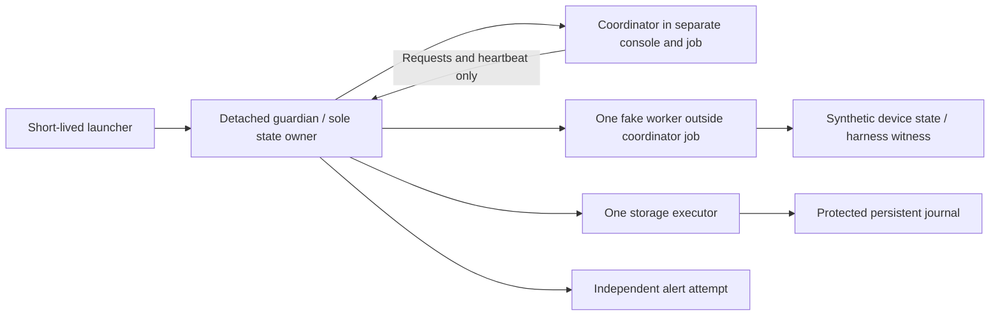
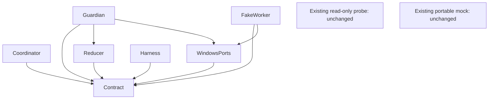

# Architecture proposal — Windows recovery infrastructure

**For human review, not implementation or hardware authorization.** `[PROPOSED]` decisions below remain unapproved. `[ADOPTED]` denotes existing constraints only. Workflow finalization means this proposal is ready for review, not that its design or any hardware experiment is approved.

The human-approved mock milestone records **55 passing tests** (32 trial, 23 probe). They were not rerun here. Its process, ownership, IPC and storage abstractions are not Windows evidence. Modern NVML P0 offset reads work on the RTX 2070 SUPER; write access and restoration remain unverified. Historical 240 W current and 215 W default are neither runtime inputs nor restoration constants.

## Review decisions and hard stops

| Proposed choice | Alternative not selected | Review consequence |
| --- | --- | --- |
| Guardian-first, detached supervisor outside any job | Coordinator creates a helper and assumes detachment implies job independence | Unsupported enclosing jobs refuse startup; no automatic escape trick |
| One canonical local root and one active trial globally | Per-user roots or independent per-session locks | Stronger exclusion, but machine-wide provisioning is still unverified |
| Versioned full journal snapshots, retained prior state and fail-closed ambiguity | Treat rename, checksum or stdout as durability | Host crash testing is required; physical power-loss durability stays unproven |
| Keep the same worker and wait for a trustworthy return | Kill a blocked worker and restore through another | Lost/blocked worker can leave recovery unresolved indefinitely |
| New fake-only infrastructure, separate from completed crates | Retrofit native process behavior into the completed simulator | Existing artifacts and behavior stay unchanged |

**No proposed mechanism proves bounded restoration during a driver hang, guardian loss, kernel failure or power loss.** If a future hardware gate requires guaranteed recovery in those cases, this design cannot meet it and the experiment must remain blocked.

## Design paradigm and boundaries

The guardian is a single state-owning actor. A pure reducer decides state transitions; platform ports provide clock observations, process events, authenticated messages and journal acknowledgements. Storage and device operations execute off the actor loop. There is no distributed consensus, cloud dependency, resident service or boot-time execution.



Dependency direction is binding; execution arrows above are not crate dependencies:



No dependency edge may be added from the existing probe or simulator into the new infrastructure. The old engine's virtual clock and owned in-memory journal/device are a behavioral oracle, not drop-in production Windows ports.

## Invariants and rules

### AD-1 — Preserve the proven boundary [ADOPTED]

- **Binds:** All units; CAP-2, CAP-6.
- **Prevents:** A recovery milestone silently becoming a hardware tool.
- **Rule:** Preserve both existing crates, probe schema 1, getter-only adapter, restricted DLL loading, opaque setter inspection, fixtures and dependency graphs. This milestone adds no NVML loader, callable hardware setter, live backend, elevation, reset or workload path. New artifacts always report synthetic device provenance. A future trial captures `B` freshly twice and rechecks it before entry; neither historical current nor default substitutes for `B`.

### AD-2 — One authority and one shared contract [PROPOSED]

- **Binds:** Coordinator, guardian, worker, storage, reducer; CAP-1–CAP-6.
- **Prevents:** Independent admission policies and incompatible shared state.
- **Rule:** Only the guardian mutates authoritative session state and issues operation permissions. Coordinator requests cannot select a raw setter value or command path. One shared contract module owns manifest canonical bytes/digest, identity normalization, typed outcomes, protocol enums, journal schema and frame codec. No separately hand-maintained serializers or timer constants. The pure reducer takes observations and emits effects; acknowledgements are inputs, never implicit success. The worker independently enforces the guardian's immutable manifest and permission ceilings.
- **Rule:** Normatively inherit protocol §2's complete manifest inventory, presentation and invalidation rules, with explicitly synthetic device/runtime provenance here. Require summary plus full manifest presentation, exact single-use approval and an independently generated unpredictable experiment nonce. Missing, generic, wrong-operator, stale or mismatched approval yields zero candidate permissions; fake operator interaction remains labeled simulated, not authenticated human consent. Preserve the proposed unapproved value policy: checked integer mW arithmetic, `1000 <= delta <= 5000`, `T = B - delta`, `min <= T < B <= max`, `min < max`; reject required unavailable/sentinel/zero/invalid readings, arithmetic overflow, drift, rounding/clamping or automatic target selection. Optional default absence alone does not invalidate valid `B`.
- **Rule:** Bootstrap has distinct `transport_ready`, `capture_ready`, `manifest_ready` and `armed` milestones. Before capture, a durable preparation capsule binds session/nonce, synthetic target selector, binaries, operator context and fixed read-only capture policy; its domain-separated preparation digest identifies preflight messages/intents, not a fabricated final manifest. `capture_ready` additionally attests lock custody and admits only serialized fake getters. Capture results seal the complete manifest, which binds the preparation trace/digest; worker acknowledges that digest as `manifest_ready`. Only exact subsequent approval and durable arm transition permit mutation. Preparation can neither provide `B` for restoration nor authorize candidate/restore operations; restart never promotes it to authority.

### AD-3 — Establish independence before readiness [PROPOSED]

- **Binds:** Launcher, guardian, coordinator, worker; CAP-3, CAP-4.
- **Prevents:** Parent console/job cleanup destroying recovery ownership.
- **Rule:** The launcher starts a detached guardian using an absolute measured executable path. Guardian must verify that it has no console attachment and is not in **any** job before readiness and again before arming. Breakaway may be requested only where Windows permits it; failure, unknown membership or remaining nested-job membership rejects startup. Do not change the enclosing job's policy. The supported alternative is explicitly launching outside that job, not installing a service, scheduled task, elevation or parent-process spoofing.
- **Rule:** Guardian creates coordinator suspended, assigns it to a dedicated job, then resumes it; worker is separate from that job and detached. Retain process handles and creation identities, not PID-only references. Explicit inherited-handle allowlists exclude console/stdout handles, unrelated secrets and guardian/worker job handles. Coordinator cannot acquire lifetime ownership through inheritance. Closing the launcher's console or terminating the coordinator's entire job must leave guardian and worker alive in acceptance tests. Survival does not extend to intentional whole-tree kills that explicitly target the guardian, logoff, shutdown or OS failure.

### AD-4 — Ownership outlives the coordinator [PROPOSED]

- **Binds:** Guardian, worker, all AutoTune recovery instances; CAP-2, CAP-3.
- **Prevents:** Two sessions, users or path aliases independently claiming the device.
- **Rule:** Use one fixed, approved canonical machine-local root for all participating recovery binaries/sessions and one stable, never-replaced `owner.lock` file opened with sharing mode zero. One active trial globally is intentionally stronger than per-device exclusion. Acquire before capture/journal inspection; hold through recovery and terminal publication. Guardian holds the ownership handle; worker receives only a lifetime duplicate of that same file handle, so guardian death cannot release ownership while the old worker remains alive. It performs no lock-file I/O. No coordinator duplicate, delete-on-close, lock stealing, PID-based stale removal or alternate-root retry.
- **Rule:** OS lock release after all holders exit is not permission for another trial. The next owner first validates every journal artifact and unresolved state. A surviving guardian cannot release ownership with an operation unresolved; after both processes die, the journal still blocks. Initialization/provisioning is separate from startup: a missing root, anchor or lock is an error, never a reason to recreate an empty store. This excludes cooperating AutoTune instances only, not external tuning tools or malicious modified binaries.
- **Rule:** Worker-ready must attest custody of the same lock file object via its lifetime duplicate before any device dispatch, including capture. Bootstrap specifies minimal handle rights and file identity; worker neither reopens nor closes it during blocked operations. Custody ends only at worker exit or safe shutdown after every permission is retired. Kill guardian at each handoff barrier to verify actual second-owner exclusion.

### AD-5 — Trust handles and protected ancestry, not supplied paths [PROPOSED]

- **Binds:** Storage, launcher, IPC, ownership; CAP-1, CAP-3.
- **Prevents:** Redirection, replacement and permissive ACLs bypassing recovery data.
- **Rule:** Admit only an explicitly configured fixed local NTFS volume/root, not temp, network, removable or synced storage. Validate owner, protected DACL and effective access on root, ancestors, lock, all journal files and executable paths. Operator/guardian access is explicit; deny broad write/create/delete access. Reject reparse traversal, unexpected hardlinks/alternate streams, root/volume/file identity changes and unsupported filesystems. Open and retain handles, prohibit ancestry rename/delete during the session, and revalidate opened objects; a leaf-only reparse flag or prior string canonicalization is insufficient. Reject if the implementation cannot establish race-resistant access.
- **Rule:** The trusted computing base includes OS, storage stack, approved binaries and operator. Same-token malicious code, an authorized editor, administrators and kernel compromise are not excluded by ACLs or checksums. Machine-wide root provisioning and cross-user rejection must be demonstrated without claiming that a user-writable directory is tamper-proof. No provisioning, ACL changes or installation occurs in this architecture session.
- **Rule:** Root, volume, lock and approved executable identities are pinned. Journal leaf IDs instead follow the authorized stage-to-active publication chain in AD-6: expected replacement is not identity drift. Unexpected leaf changes still reject. Retaining ancestry handles must not imply retaining leaf handles with sharing that prevents replacement.

### AD-6 — Publication precedes permission, not recovery responsiveness [PROPOSED]

- **Binds:** Guardian, storage executor, startup scanner; CAP-1, CAP-3, CAP-5.
- **Prevents:** Lost intents, replayed approval and disk stalls suppressing cleanup.
- **Rule:** Guardian is the only journal writer through one serialized storage executor. Pre-capture snapshots bind the preparation capsule; after sealing they bind the full immutable manifest and its preparation lineage. Snapshots include consumed-nonce history, complete ordered call intents/results, session/process identities, immutable timing, operation/record sequence, prior digest and terminal evidence. Include typed unavailable values and raw failures. Secrets are never persisted. No import can authorize execution, choose binaries or choose a DLL.
- **Rule:** For each publication: create a fresh same-directory stage file exclusively; write the complete bounded snapshot and integrity data; `FlushFileBuffers`; publish with same-volume `ReplaceFileW` retaining a unique prior backup; reopen the published file, validate identity/ACL, flush and read back exact bytes. Existing initialized anchor is required. No ignored ACL/merge errors, unsupported `REPLACEFILE_WRITE_THROUGH` promise or backup deletion during an active/unreconciled session. Failure or timeout at any step is publication failure, even if replacement actually occurred.
- **Rule:** Persist consumed nonce and unresolved session before arming; persist candidate intent before candidate dispatch; acknowledge arm only after guardian validation. Reserve an operation before requesting publication, and do not dispatch a late acknowledgement after admission closes. Before any restore, attempt `restore_pending` publication when storage is healthy; once mutation is possible, failed/hung storage cannot hold safe authorized cleanup hostage. Guardian keeps the immutable recovery capsule and call ledger in RAM. Storage effects cannot reopen admission or turn a previously timed-out publication into success. At most one storage request remains outstanding; quarantine its late acknowledgement and make no concurrent writes.
- **Rule:** Restart scans active, backup and stage artifacts under ownership. Require one unambiguous validated history with consistent immutable fields and nonce ledger. Torn, missing, unknown-schema, conflicting, higher-sequence partial or unexplained extra artifacts block; do not choose an older clean/closed backup and declare success. Preserve prior valid recovery data as evidence, not execution authority. Durable terminal closure requires completed device verification, no outstanding operations/publications and a successful terminal publication. Namespace crash persistence and physical power-loss durability remain gates, not consequences of this algorithm.
- **Rule:** One guardian-owned storage **thread**, not an independently surviving process, owns all publication handles. Stage identity is measured after writing; close its flushed handle and any incompatible leaf handles before replacement, then require the reopened active file ID to equal that stage ID and verify expected backup lineage. Keep ancestry protection throughout. Lock release requires storage thread completion during orderly shutdown; process death cannot leave another application-level publisher alive. Residual kernel/storage I/O and crash namespace ordering remain G3 evidence requirements, not assumed fencing.
- **Rule:** Reserve and record exact intent before **every** device dispatch, including capture/enumeration/identity/bounds/getters; record return before later progression. Before possible mutation, publication failure stops progression. After possible mutation, RAM preserves identical ordering and the pending slot while only safe bounded cleanup proceeds. Each publication has a guardian deadline at request time +100 ms, capped by remaining session/recovery budget; this new infrastructure ceiling is proposed, not approved hardware policy. A late acknowledgement never renews it. While storage is healthy, await intent/result publication acknowledgement before device progression, including restore. Explicit failure or expiry of this bounded publication wait marks storage failed; after possible mutation, bypass further waits for otherwise-safe cleanup with RAM-only evidence and no durable-success claim. A stalled publisher remains quarantined with no concurrent replacement writer. If the overall cleanup deadline wins, do not dispatch a late restore.
- **Rule:** Snapshots carry a global increasing record sequence and complete retained session history. A new session is legal only after the prior session's validated terminal publication and no outstanding worker/storage effects; its opening record binds the prior terminal digest and carries the entire consumed-nonce ledger forward. Manifest consistency is per session; cross-session consistency follows this explicit chain. Backups/stages must be members or explainable prefixes of that chain, never a reason to forget a nonce. No automatic compaction/deletion: capacity exhaustion blocks new sessions. Rollover crash ambiguity blocks startup like other publication ambiguity.

### AD-7 — Authenticate capabilities, peers and messages [PROPOSED]

- **Binds:** Coordinator/guardian/worker IPC, launcher; CAP-1, CAP-4.
- **Prevents:** Pipe squatting, replay, arbitrary commands and PID-reuse impersonation.
- **Rule:** Guardian owns separate local overlapped named pipes for coordinator and worker: unpredictable names, explicit logon-SID DACL, remote rejection, first-instance enforcement, one expected peer per channel and least-specific access rights (not a default DACL). Bind both ends to retained process handles/creation identities, expected token/logon/integrity context and measured binary identity. Failed identity checks close the channel; PID alone is insufficient.
- **Rule:** Generate separate 256-bit session keys using OS CNG RNG. Transfer through private bootstrap handles on explicit child inheritance lists, never argv, environment, files or reports. Mutual HMAC-SHA256 challenge-response binds fresh challenges, roles, process identities, session and protocol version. Every frame MAC binds its complete length/header/payload and direction; constant-time verification precedes dispatch. No reconnect, new peer or fresh key can inherit an armed session. Authentication establishes a trusted process capability, not genuine human understanding or hardware consent.
- **Rule:** Contract v1 frames are bounded to 64 KiB with a little-endian u32 body length; the shared strict encoder owns fixed field order and integer representations. Authenticated body includes protocol version, role/direction, session ID, manifest digest, generation, increasing per-direction sequence, operation ID, message kind and typed payload. Reject duplicate/unknown fields, invalid lengths, sequence gaps/replays, wrong generation/digest, unsupported versions and arbitrary-value commands; do not retry a command after an uncertain send. Publish golden bytes and malformed-frame tests before units integrate. Worker return messages for the one outstanding old-generation operation are accepted as evidence after candidate generation closes; they cannot renew permission.
- **Rule:** Completion is one authenticated atomic `ReturnAndIdle` frame binding the exact retired permit and its original generation. Its tagged outcome is either `NotEntered(reason)` or `Returned(entry_time, return_time, raw_result)`; idle certifies no queued work and no remaining permit. Validate MAC/session/peer/sequence first, then accept a closed-generation completion **only** for the outstanding operation; generation rejection must not discard its evidence. Distinguish reserved, dispatched and entered counters; retiring an unused candidate permit never permits reissue. On malformed/lost completion retain uncertainty.
- **Rule:** Before independent units build, the shared bootstrap schema must specify trusted field sources and ordering: guardian supplies role, session ID, key, pipe locator, guardian/child creation identities, expected measurements and a restricted guardian query/synchronize handle via private inherited bootstrap; child validates those objects before pipe authentication. After mutual authentication, preparation capsule is acknowledged before capture readiness; completed manifest is transferred and digest-acknowledged before manifest readiness/arm, following AD-2. Keys differ by role/channel; guardian creates child identities and verifies their actual process/token objects. No unauthenticated peer claim may fill a missing trust field. Rights, closure ordering, transcript vectors and worker lock custody are mandatory shared pre-build contracts.

### AD-8 — Expiry is absolute and not renewable [PROPOSED]

- **Binds:** Reducer, guardian, worker, clock port; CAP-1, CAP-4.
- **Prevents:** Heartbeats, restart, suspend or delayed dispatch extending authority.
- **Rule:** Preserve protocol policy as proposed, unapproved ceilings: capture reads 500 ms apart; approval expires at explicit UTC expiry or capture+60 s, earlier wins; lease arm+10 s; candidate entry before arm+2 s; 1000 ms per-operation watchdog; 250 ms heartbeat / 1000 ms loss; normal recovery immediately after candidate readback and requested by arm+3 s; 5 s recovery budget from the first trigger; two final reads 250 ms apart; one candidate / two restores maximum. Deadline ties revoke admission before completion/dispatch. Arm time is frozen when guardian commits its arm acknowledgement, not when coordinator receives it. All arithmetic is checked.
- **Rule:** Use boot-relative interrupt time including sleep for absolute deadlines; compare unbiased interrupt time and power-state observations to detect suspend/resume. Compare UTC against monotonic progression; detected discontinuity or missing clock evidence invalidates admission. No timer-resolution changes or clock-origin reconstruction after restart. Wakeups are advisory: resample all clocks before transitions and worker entry. Worker checks the immutable candidate expiry and guardian liveness immediately before fake-call entry, and restore deadline before each cleanup call. Recovery deadlines never restart after repeated notifications, queued events or late returns.
- **Rule:** Define and test clock-discontinuity resolution/tolerance in the clock port before implementation acceptance. Reliable detection of every discontinuity and an exact physical FFI-entry deadline across arbitrary scheduling/suspend gaps are **not proven** by polling or an IPC grant. If strict entry timing cannot be established for a future native adapter, retain the live block; never relabel dispatch time as entry time.
- **Rule:** Device watchdog starts at guardian dispatch attempt (including pre-arm capture), not entry acknowledgement; it expires at dispatch+1000 ms or an earlier enclosing deadline and cannot restart on receipt/entry/return. Each permission MAC-binds that dispatch-origin watchdog deadline and applicable preparation/manifest digest plus candidate/cleanup expiry; worker rejects entry at the earliest ceiling for every operation, including preflight getters. A call already entered can outlast its watchdog, remaining pending. Worker recovery permissions also bind the first-trigger time and absolute cleanup deadline in the shared boot-relative clock domain, along with exact session/operation/manifest. Worker may independently tighten to an earlier locally observed fault+5 s, reports that evidence, and never extends to receipt+5 s. Guardian applies the minimum reported deadline; an unknown/mismatched epoch rejects entry. Check guardian liveness before **every** call, including restore; observed guardian loss retires unused permission without entry, while already entered calls may return but cannot start a successor. This is observed liveness, not instantaneous native-death fencing.
- **Rule:** Shared contract limits actor ingress to 64 pending events and at most 8 ordinary events per turn, with fresh actor-clock sampling and priority revocation/recovery checks between events. Validate authenticated sequence before coalescing redundant heartbeats; queue overflow closes admission rather than dropping completion evidence. Reserve completion/control capacity separately from ordinary requests. Frame validation/encoding and storage scans run off-loop with bounded results; no stale enqueue timestamp becomes current time. Proposed store ceilings are 4 MiB per snapshot, 1024 artifacts and 256 retained sessions/nonces; reject new sessions before capacity runs out, never erase authority history to fit. Boundary/flood tests must demonstrate behavior; these are resource ceilings, not scheduler latency guarantees.

### AD-9 — One outstanding operation until proven returned [PROPOSED]

- **Binds:** Guardian, worker, transport, cancellation; CAP-3–CAP-5.
- **Prevents:** Restoration racing a queued, blocked or late candidate/getter.
- **Rule:** Serialize **all** device calls, including enumeration, identity/bounds/current getters and verification. Worker has one execution lane, no internal command pipeline and no independent retry. Guardian reserves an operation before publishing its intent and retains it through uncertain dispatch. Every dispatch requires the matching permission; candidate carries only `CandidateOnce`, restore only `RestoreBaseline`, never raw values. Only the worker resolves the immutable manifest's `T` or `B`.
- **Rule:** Timeout, cancel, disconnected IPC, failed send, missing acknowledgement, worker exit or process termination never clear an operation that may have entered. Quiescence requires the same authenticated worker's exact operation result plus idle acknowledgement emitted after return, no queued work and no outstanding permit. Late return can establish this within the original recovery budget; after budget expiry it is evidence only. No replacement worker, parallel getter or restore is permitted while quiescence is unknown. Worker death after dispatch leaves recovery-required even if Windows reports process exit.
- **Rule:** Closing admission invalidates queued candidate generations. An already-dispatched permit is conservatively possible entry and must be resolved; cancellation is not a promise that an in-flight operation never starts. A worker-side race between checking revocation and entry cannot authorize competing restoration. Genuine native driver-call fencing remains an unmet prerequisite, not a property inferred from fake workers or an idle packet.
- **Rule:** Every entry independently validates operation-specific required API availability and immutable API identity as well as identity/runtime/bounds/ownership. Later symbol loss rejects entry and triggers or retains recovery-required when cleanup cannot proceed; no alternate API, command, reset or escalation fallback. Fake API availability flags test this contract without binding native functions.
- **Rule:** Validation is an explicit finite sequence, not hidden calls or recursive preconditions. Every getter is its own journaled/dispatched operation; enumeration and identity getters validate their own selector/session/API/ownership and returned identity, not a prerequisite getter of themselves. Bounds/current/runtime checks then consume explicit results on the resolved handle, rejecting stale/out-of-order evidence. Before candidate/restore the guardian schedules the required fresh validation sequence, and the worker checks that completed evidence chain plus local capability/identity/permission state before entry. No setter may issue an untraced validation getter internally; no claim is made that this sequential snapshot excludes external hardware changes between operations.

### AD-10 — Recovery is bounded authority, not automatic takeover [ADOPTED]

- **Binds:** Guardian, worker, startup; CAP-2–CAP-5.
- **Prevents:** Cancel stopping needed cleanup, blind writes and false restoration.
- **Rule:** First cancellation, parent/IPC/heartbeat loss, expiry, clock fault, storage failure or candidate error permanently closes candidate admission and freezes recovery start/deadline. Restore permission survives candidate lease expiry only within that cleanup budget. Once quiescent, recheck exact identity, unchanged runtime/bounds and ownership, then explicitly restore captured `B`, even if already read as `B`. Never round, clamp, use default/history, reset or switch API. Invalid prerequisites or unknown quiescence mean recovery-required, not a speculative write.
- **Rule:** At most two serialized restores; the second requires completed unsuccessful verification and remaining budget. Require explicit restore attempt and two exact fresh baseline reads 250 ms apart, matching identity and no pending calls for observed restoration. API failure remains a failure even if baseline restoration is observed. Guardian loss stops autonomous progression; no standby takeover, restart replay, new lease or automatic reconciliation clear. Startup is read-only. Later recovery-only mutation needs separate exact approval and a separately reviewed design.

### AD-11 — Test real infrastructure, never real device mutation [PROPOSED]

- **Binds:** Build boundaries, harness, platform ports; CAP-6.
- **Prevents:** Simulator results masquerading as OS or hardware guarantees.
- **Rule:** New infrastructure ships only fake-worker executables, with no selectable native backend, DLL path, arbitrary executable override, NVML dependency or live feature flag. Bare invocation shows help; unsupported platforms fail closed. Tests operate actual Windows processes, jobs, private IPC, locks, ACLs and files in approved isolated test roots; device identity and state remain synthetic. Shared-state fake hardware/witness survives worker termination, so killing the worker cannot erase a possible late effect from the test oracle. Harness barriers control interleavings, not long sleeps.
- **Rule:** Apply the companion's infrastructure matrix plus all inherited M01–M32 invariants as applicable. Preserve original 55 tests and existing mutation guards. Model tests, host process-crash tests, OS-crash tests and physical power-loss claims must be reported separately. No VM reboot, destructive disk test, elevation or machine configuration change is implied by fake-only implementation approval.

### AD-12 — Evidence and alerts cannot depend on the lost coordinator [PROPOSED]

- **Binds:** Guardian, reports, operator recovery; CAP-3, CAP-5.
- **Prevents:** Hidden uncertainty and durable-success claims from transient output.
- **Rule:** Report separately candidate API status, candidate readback, restore API history, observed baseline restoration, publication verification/durability tier, remaining pending operation and overall recovery/trial result. Keep earlier failures. `recovery_required` retains evidence and ownership while an old worker can still run; no success from stdout, an API return alone or startup reading `B`.
- **Rule:** Guardian attempts an independent local notification plus a privacy-protected recovery notice containing session/device identity, captured `B`, uncertain operation and journal location. Notification delivery is not guaranteed; write failure or lost display cannot be reported as successful alerting. Persistent unresolved journal and startup exclusion remain primary evidence. Redact device identifiers on export. No alert launches a recovery command or assumes human attention.
- **Rule:** Preserve and report all timing violations, specifically a missed arm+3 s normal-recovery request even when subsequent restoration and terminal publication succeed.

## Structural seed and operational envelope

No stack migration: retain Rust edition 2021 and the repository's declared/tested Rust 1.99.1 baseline. No new Rust native-binding package/version is selected here; bind it only after current-version, license, API coverage and MSVC/GNU fit checks. Win32 and Windows CNG API fit was checked against Microsoft documentation on 2026-10-17 (companion sources). API availability is not tested host support.

```text
crates/                         # proposed additions only; names are seed
  autotune-recovery-contract/   # shared strict schemas, codec, reducer inputs
  autotune-recovery-core/       # pure guardian reducer and effect contracts
  autotune-recovery-windows/    # reviewed Win32/CNG ports, isolated unsafe layer
  autotune-recovery-harness/    # launcher/guardian/coordinator/fake-worker roles
```

Deployment: one local interactive operator on an explicitly tested, supported Windows desktop build with the required Windows 10+ APIs and local NTFS. No install, autostart, driver, service, task, remote listener or backend provider. Run binaries from an approved measured location, not a journal-specified path. Failure to provision a common protected persistent root is a rejection, not fallback to temp. Disposable test roots may use the approved OpenCode temporary directory for process-crash tests only and confer no production durability qualification.

## Capability → architecture map

| Capability | Lives in | Governing decisions |
| --- | --- | --- |
| CAP-1 exact single-use authority | Contract, guardian, authenticated coordinator ingress | AD-2, AD-6–AD-8 |
| CAP-2 identity, fresh baseline, ownership | Worker, guardian, canonical store | AD-1, AD-4, AD-5, AD-9, AD-10 |
| CAP-3 retained recovery intent | Guardian, storage, ownership, alert | AD-3–AD-6, AD-9, AD-12 |
| CAP-4 independent expiry and cancellation | Guardian reducer, clocks, worker | AD-3, AD-7–AD-10 |
| CAP-5 distinct verified evidence | Worker results, guardian, journal | AD-6, AD-9, AD-10, AD-12 |
| CAP-6 no-hardware demonstration | Windows harness plus existing regression suites | AD-1, AD-2, AD-11 |

## Deferred and unresolved gates

| Item | Boundary / revisit condition |
| --- | --- |
| Shared codec field-level schema and golden vectors | One owner in AD-2; complete before parallel implementation/integration, never independently invent wire types |
| Exact Windows build, binding crate/version and toolchain matrix | Select and verify before Windows implementation; no compatibility claim for all Windows hosts |
| Clock tolerance, suspend notifications and entry checks | Resolve before infrastructure acceptance; strict native entry remains a live blocker |
| Machine-wide root provisioning and approved ACL/privilege policy | Must be reviewed before production use; unprivileged single-account tests cannot prove other-user enforcement |
| Journal namespace persistence and real storage power-loss semantics | Process crashes cannot prove either OS-crash or power-loss behavior; separate authorized destructive environment and documented assumptions required |
| Native call return/fencing and restore semantics | Fake idle/return evidence applies only to fakes. No proven Windows/NVML fence after worker loss: live experiment blocked |
| Exact future native API boundary | Any separately approved adapter remains constrained to original `nvmlDeviceSetPowerManagementLimit`, configured-limit `nvmlDeviceGetPowerManagementLimit` and `nvmlDeviceGetPowerManagementLimitConstraints`, integer mW; no v2/scope, effective-limit/power-usage substitution, command fallback, denial-driven escalation, persistence change or shutdown/reset/reboot-as-restoration |
| Trusted human approval and binary measurement | IPC authentication is not a secure-attention path; executable hashes alone are not supply-chain or same-token isolation proof. Review before native capability |
| External tuning/profile exclusion | AutoTune ownership does not lock other tools. Operator inspection plus drift detection cannot prove exclusive hardware ownership |
| Hardware permissions, exact fresh capture, manual recovery and physical restoration | Remain unverified; separate device-specific preparation and exact execution consent required |
| Expanded architecture beyond this feature | UI, optimizer, performance/stability/stress tests, offsets, boot recovery, services and recovery-only writes are outside scope |

**Next review gate:** accept/revise the proposed infrastructure boundaries, then adopt this companion into the spec with stable AD IDs. No implementation starts in this session; no hardware experiment follows from design approval.
